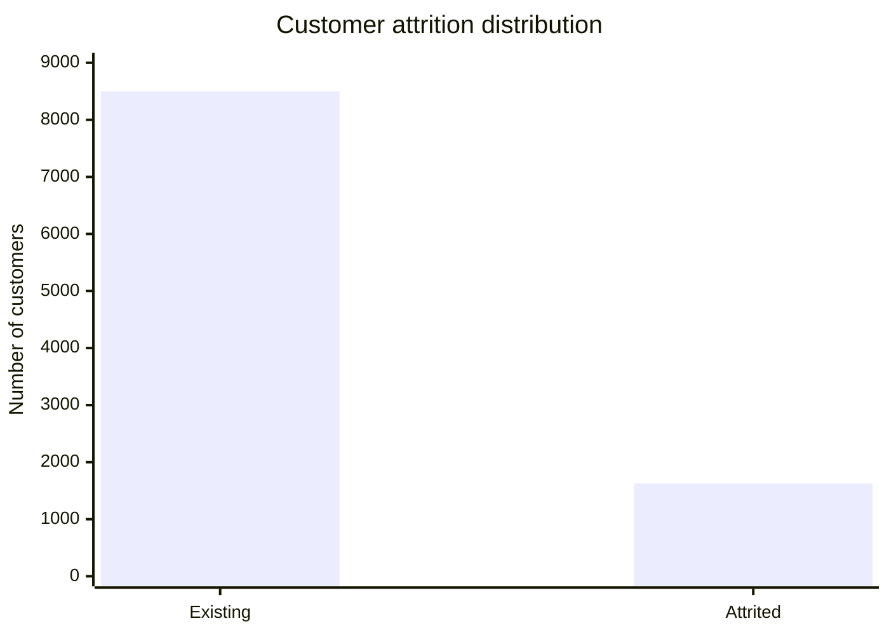
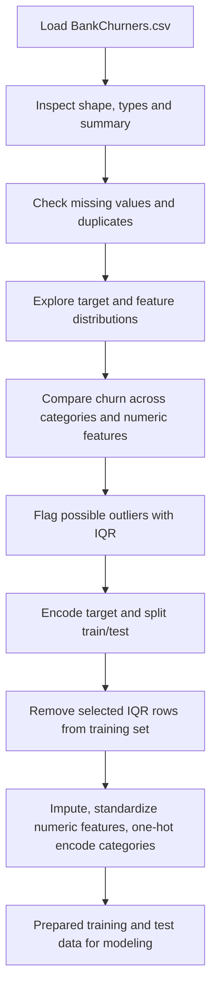

# Bank Customer Churn: EDA and Preprocessing Report

## 1. Project objective

The goal of this work was to explore the Bank Churners dataset and prepare its features for a future machine learning model that predicts whether a customer is existing or attrited. Exploratory data analysis (EDA) helps us understand the data before making decisions. Preprocessing makes the data usable by machine learning algorithms.

The target column is `Attrition_Flag`.

## 2. Dataset overview

The dataset contains **10,127 rows and 23 columns**. It includes customer details, account information, transaction measurements, the churn label, and two Naive Bayes score columns. The two score columns are related to the target and are excluded from model inputs to avoid giving a model information derived from the answer.

The `CLIENTNUM` column identifies a customer. It is useful for reference but is not a meaningful measurement of customer behavior, so it is excluded from model inputs too.

## 3. Main graph: target distribution

The target count plot shows that existing customers are much more common than attrited customers.

| Target class | Customers | Percentage |
|---|---:|---:|
| Existing Customer | 8,500 | 83.93% |
| Attrited Customer | 1,627 | 16.07% |

**What it tells us:** The classes are imbalanced: about five existing customers appear for every attrited customer. A model could get a seemingly high accuracy by mostly predicting “Existing Customer,” while still missing many customers who leave.

**Why it is useful:** This plot provides context for later model evaluation. When a model is built, accuracy should be considered alongside metrics such as recall, precision, F1-score, and the confusion matrix. The train/test split uses stratification so both sets keep a similar class ratio.

## 4. What we did and why

### 4.1 Loaded and inspected the data

We loaded `BankChurners.csv`, displayed a random sample, printed the column names, checked data types and row counts with `info()`, and reviewed numerical summary statistics with `describe()`.

**Why:** This first check confirms the file loaded correctly, shows the dataset’s size and types, and gives a quick view of the numerical ranges. It helps catch unexpected columns, incorrect data types, and implausible values early.

**What we found:** There are 10,127 records and 23 columns. The numeric measurements include customer age, credit limit, transaction amount, transaction count, and utilization ratio. Several columns are categorical, such as gender, education, income, card category, and attrition status.

### 4.2 Checked missing values and duplicate rows

We counted missing values and exact duplicate rows. The recorded output showed **no missing values and no duplicate rows**. The cleaning code still removes duplicate rows and records with a missing target, so it can handle those problems if they appear in a different copy of the data.

**Why:** Missing values can prevent some analyses or model steps from working. Duplicate rows can make repeated observations count more than once and distort results.

**Usefulness:** This check tells us whether data-cleaning steps are necessary. Here, the checks show the dataset is complete as provided, and cleaning did not change its size.

### 4.3 Examined numerical feature distributions

Histograms were created for numerical features, followed by boxplots. The customer ID and the target-derived Naive Bayes columns were excluded from these plots because they are not ordinary behavioral measurements.

**Why:** Histograms show the shape and spread of a feature, including skew and concentration. Boxplots give a compact view of the median, quartiles, and values far from the central range.

**Usefulness:** These plots help identify features that may need closer inspection, guide the choice of scaling, and provide an initial view of possible outliers. A point outside a boxplot’s whiskers is only a statistical flag; it is not automatically a data error.

### 4.4 Examined relationships between numerical features

A correlation heatmap was used to visualize pairwise linear relationships among numerical features.

**Why:** Highly related features can contain overlapping information. Correlation is a useful first check for redundancy and can help explain patterns before modeling.

**Usefulness:** The heatmap is a compact way to scan many pairs at once. Correlation does not prove that one feature causes another, and a low correlation does not rule out a more complex relationship.

> **Notebook run note:** In the pasted notebook, the heatmap cell uses `correlation_matrix`, but the visible cell sources do not show where it is assigned. It ran in the saved session, which may mean the variable was created in an earlier cell that is not included. For a fresh “Run All,” make sure this line appears before the heatmap: `correlation_matrix = df[numerical_columns].corr()`.

### 4.5 Compared churn across categories

For each categorical feature, the notebook calculated the percentage of customers in each attrition class within that category and plotted the attrited-customer percentage.

**Why:** Raw counts can be misleading when categories have different numbers of customers. Percentages make category-level churn rates easier to compare.

**Examples from the output:**

- Churn was 17.36% for women and 14.62% for men.
- The displayed education groups ranged from 15.20% for College and High School to 21.06% for Doctorate.
- Marital-status rates ranged from 15.13% for Married to 17.22% for Unknown.
- Income-category rates ranged from 13.48% for `$60K - $80K` to 17.33% for `$120K +`.
- The displayed card-category rates ranged from 14.77% for Silver to 25.00% for Platinum.

**Usefulness:** These charts help identify groups for further investigation and communicate the patterns in an understandable way. Some categories, such as Platinum or Doctorate, may contain relatively few customers, so their percentages can be less stable. These are descriptive associations and do not show that the category causes churn.

### 4.6 Compared numerical features by attrition status

Boxplots were drawn for each numerical feature with separate boxes for existing and attrited customers.

**Why:** This allows a direct visual comparison of the distributions in the two target groups, including their medians, spread, and unusual values.

**Usefulness:** A feature that looks different between groups may be helpful for prediction and worth examining more closely. A visual difference alone does not establish that a feature is important in a model.

### 4.7 Detected possible outliers with the IQR rule

For each numerical feature, the notebook calculated the first quartile (Q1), third quartile (Q3), and interquartile range (IQR = Q3 − Q1). It flagged values below `Q1 − 1.5 × IQR` or above `Q3 + 1.5 × IQR`.

The largest flagged percentages in the full dataset were:

| Feature | IQR flags | Percentage |
|---|---:|---:|
| Credit_Limit | 984 | 9.72% |
| Avg_Open_To_Buy | 963 | 9.51% |
| Total_Trans_Amt | 896 | 8.85% |
| Contacts_Count_12_mon | 629 | 6.21% |
| Total_Amt_Chng_Q4_Q1 | 396 | 3.91% |

**Why:** IQR provides a consistent, simple way to find unusually distant values without assuming a normal distribution.

**Usefulness:** The summary helps prioritize which features to inspect. In this banking dataset, high credit limits or transaction amounts may be legitimate customer behavior, so the IQR result should not be treated as proof of an error.

### 4.8 Split the data and removed flagged training rows

The target was mapped to numbers (`Existing Customer` = 0 and `Attrited Customer` = 1). The data was split into 80% training data and 20% test data using stratification. The IQR limits were then calculated on the training data. Rows outside the selected limits in any chosen continuous numerical feature were removed from the training set; the test data was kept unchanged.

| Stage | Rows |
|---|---:|
| Training set before outlier removal | 8,101 |
| Training rows flagged and removed | 2,170 (26.79%) |
| Training set after removal | 5,931 |
| Test set kept unchanged | 2,026 |

**Why split first:** The test set is meant to represent unseen data. Calculating outlier thresholds using it would allow information from the test set to influence preprocessing. Keeping it unchanged also preserves a more realistic evaluation set.

**Important interpretation:** Removing **26.79%** of the training records is a large change. The row rule removes a record if it is flagged in any selected feature, so moderately unusual values across several columns can add up to many removed records. This could remove legitimate customers or change the target-class balance. Before using this result in a final model, compare the number and class percentages before and after removal, inspect examples, and consider keeping the records or capping extreme values instead. If removal is retained, explain the reason and report the effect.

### 4.9 Encoded categories and standardized numerical features

The notebook uses a preprocessing pipeline:

- **Median imputation** for numerical values, if missing values occur later.
- **StandardScaler** for numerical features, which centers values around a mean of 0 and scales them to a standard deviation of 1.
- **Most-frequent imputation** for categorical values, if missing values occur later.
- **One-hot encoding** to turn categories into binary indicator columns. `handle_unknown='ignore'` allows the transformer to handle a category that did not appear in training.

The preprocessing is fitted on the training set and then applied to both training and test sets. The recorded output has **37 processed features**, with 5,931 training rows and 2,026 test rows.

**Why:** Many machine learning methods work better when numeric inputs are on comparable scales. Models also need categorical values represented numerically. Fitting the transformations on training data only prevents test-set information from influencing the learned scaling or category representation.

**Usefulness:** The same fitted preprocessing can be reused consistently for future data. Standardization is especially useful for distance-based and regularized models. Tree-based models often need less scaling, but encoding is still needed by many implementations.

## 5. Overall workflow

## 6. Conclusion

The analysis gives a broad view of the dataset: it is complete, contains 10,127 records, and has a target class imbalance with 16.07% attrited customers. The notebook uses graphs to explore numerical distributions, possible outliers, correlations, and churn rates across customer groups. It also prepares model inputs by excluding identifier and target-derived fields, splitting the data, applying IQR-based training-row removal, encoding categorical features, and standardizing numerical features.

The main point to revisit is the outlier-removal result: it removes over one quarter of the training rows. That decision should be justified with a comparison of class balance and model results, or replaced with a less aggressive treatment if the flagged values are valid customers. Also ensure the correlation matrix is created in the notebook before running the heatmap cell from a fresh kernel.
